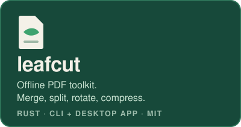

  

  <a href="https://nexnexus.com">nexnexus.com</a> ·
  <a href="https://www.blackflagbytes.com">blackflagbytes.com</a> ·
  <a href="https://www.linkedin.com/in/hytztrk">LinkedIn</a>

  
  
  

<b>&nbsp;English&nbsp;</b>

 

I run engineering at **[NEXNEXUS](https://nexnexus.com)**, where we build enterprise software, custom ERP
solutions and the integrations around them. At **[BlackFlagBytes](https://www.blackflagbytes.com)** I design
games. In between, I write small tools I wanted to exist and publish them here.

The common thread is a preference for software that is light, runs on one codebase across platforms, and
does not need a server or an account to be useful.

### Open source

| | What it is | Why it exists |
|---|---|---|
| **[leafcut](https://github.com/hytztrk-ux/leafcut)** | Merge, split, rotate and compress PDFs from a desktop app or the terminal | PDF chores should not require uploading a contract to a website |
| **[watchpost](https://github.com/hytztrk-ux/watchpost)** | Uptime checks for sites, ports and TLS certificates, with alerts and a status page | Monitoring a small server should not cost more memory than the server has to spare |
| **[neatly](https://github.com/hytztrk-ux/neatly)** | A file organizer driven by a few TOML rules | Tidying Downloads is only safe if you can preview it first and undo it afterwards |

All three are written in Rust, MIT licensed, documented in English and Turkish, and ship prebuilt binaries
for Linux, macOS and Windows.

Also here: **[DD:YZ](https://github.com/hytztrk-ux/SansursuzLokalAIStudyosu-DDYZ)**, a portable studio for
running image, chat and speech models locally.

### Day to day

- **Enterprise systems.** ERP architecture and customisation on Canias ERP and TROIA, backend services, and the REST and SOAP integrations that connect them to everything else.
- **Cross-platform products.** Desktop and server software from a single codebase, mostly with Go, Rust, Tauri 2 and PostgreSQL.
- **Games.** Design and tooling at BlackFlagBytes.
- **Local AI.** Models and tooling that run on your own hardware.

Off the keyboard: collecting and playing electric guitars.

<b>&nbsp;Türkçe&nbsp;</b>

 

**[NEXNEXUS](https://nexnexus.com)**'ta mühendisliği yönetiyorum; kurumsal yazılım, özel ERP çözümleri ve
bunları birbirine bağlayan entegrasyonlar geliştiriyoruz. **[BlackFlagBytes](https://www.blackflagbytes.com)**'ta
oyun tasarlıyorum. Arada, var olmasını istediğim küçük araçları yazıp burada yayınlıyorum.

Hepsinin ortak noktası aynı tercih: hafif, tek kod tabanıyla her platformda çalışan ve işe yaraması için
sunucu ya da hesap gerektirmeyen yazılım.

### Açık kaynak

| | Ne yapar | Neden var |
|---|---|---|
| **[leafcut](https://github.com/hytztrk-ux/leafcut/blob/main/README.tr.md)** | PDF'leri masaüstü uygulamasından ya da terminalden birleştirir, böler, döndürür, sıkıştırır | Bir PDF'i düzenlemek için sözleşmenizi bir web sitesine yüklemek zorunda kalmamalısınız |
| **[watchpost](https://github.com/hytztrk-ux/watchpost/blob/main/README.tr.md)** | Siteleri, portları ve TLS sertifikalarını izler; uyarı gönderir, durum sayfası sunar | Küçük bir sunucuyu izlemek, sunucunun ayırabileceğinden fazla bellek harcamamalı |
| **[neatly](https://github.com/hytztrk-ux/neatly/blob/main/README.tr.md)** | Birkaç TOML kuralıyla çalışan dosya düzenleyici | İndirilenler klasörünü toplamak, ancak önce önizleyip sonra geri alabiliyorsanız güvenlidir |

Üçü de Rust ile yazıldı, MIT lisanslı, İngilizce ve Türkçe belgeli; Linux, macOS ve Windows için hazır
derlenmiş sürümleri var.

Ayrıca: **[DD:YZ](https://github.com/hytztrk-ux/SansursuzLokalAIStudyosu-DDYZ)**, görsel, sohbet ve ses
modellerini yerelde çalıştıran taşınabilir bir stüdyo.

### Günlük iş

- **Kurumsal sistemler.** Canias ERP ve TROIA üzerinde ERP mimarisi ve özelleştirme, backend servisleri ve bunları diğer her şeye bağlayan REST ve SOAP entegrasyonları.
- **Çapraz platform ürünler.** Tek kod tabanından masaüstü ve sunucu yazılımı; çoğunlukla Go, Rust, Tauri 2 ve PostgreSQL ile.
- **Oyun.** BlackFlagBytes'ta tasarım ve araç geliştirme.
- **Yerel yapay zekâ.** Kendi donanımınızda çalışan modeller ve araçlar.

Klavye başında değilken: elektro gitar koleksiyonu ve müzik.

---

<table>
  <tr><td><b>Languages / Diller</b></td><td>Rust · Go · JavaScript · TROIA</td></tr>
  <tr><td><b>Desktop &amp; runtime / Masaüstü ve çalışma ortamı</b></td><td>Tauri 2 · Node.js</td></tr>
  <tr><td><b>Data &amp; integration / Veri ve entegrasyon</b></td><td>PostgreSQL · SQLite · REST / JSON · SOAP / XML</td></tr>
  <tr><td><b>Enterprise / Kurumsal</b></td><td>Canias ERP</td></tr>
</table>

Ankara

