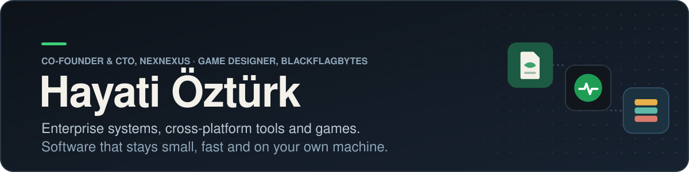
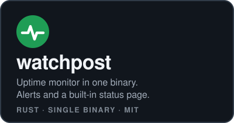
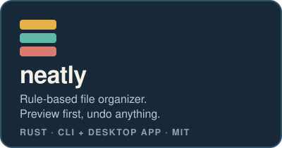

  

  <b>English</b> · <a href="https://github.com/hytztrk-ux/hytztrk-ux/blob/main/README.tr.md">Türkçe</a>

  <a href="https://nexnexus.com">nexnexus.com</a> ·
  <a href="https://www.blackflagbytes.com">blackflagbytes.com</a> ·
  <a href="https://www.linkedin.com/in/hytztrk">LinkedIn</a>

  
  
  

I run engineering at **[NEXNEXUS](https://nexnexus.com)**, where we build enterprise software,
including our own ERP platform, and the integrations around it. At **[BlackFlagBytes](https://www.blackflagbytes.com)** I design
games. In between, I write small tools I wanted to exist and publish them here.

The common thread is a preference for software that is light, runs on one codebase across platforms, and
does not need a server or an account to be useful.

### Now building: ORENA

> **An AI-native ERP, written from scratch.**

Most business software had AI added to it afterwards. ORENA starts from it. We are rethinking how a company
runs its day, from the first screen to the last report, and building it in-house at NEXNEXUS.

The details stay under wraps until it is ready. It is the thing I am most impatient to show.

### Open source

| | What it is | Why it exists |
|---|---|---|
| **[leafcut](https://github.com/hytztrk-ux/leafcut)** | Merge, split, rotate and compress PDFs from a desktop app or the terminal | PDF chores should not require uploading a contract to a website |
| **[watchpost](https://github.com/hytztrk-ux/watchpost)** | Uptime checks for sites, ports and TLS certificates, with alerts and a status page | Monitoring a small server should not cost more memory than the server has to spare |
| **[neatly](https://github.com/hytztrk-ux/neatly)** | A file organizer driven by a few TOML rules | Tidying Downloads is only safe if you can preview it first and undo it afterwards |

All three are written in Rust, MIT licensed, documented in English and Turkish, and ship prebuilt binaries
for Linux, macOS and Windows.

Also here: **[DD:YZ](https://github.com/hytztrk-ux/SansursuzLokalAIStudyosu-DDYZ)**, a portable studio for
running image, chat and speech models locally.

### Day to day

- **Enterprise systems.** An ERP platform we are building in-house, backend services, and the REST and SOAP integrations that connect them to everything else. Before that I spent years working with Canias ERP and TROIA.
- **Cross-platform products.** Desktop and server software from a single codebase, mostly with Go, Rust, Tauri 2 and PostgreSQL.
- **Games.** Design and tooling at BlackFlagBytes.
- **Local AI.** Models and tooling that run on your own hardware.

Off the keyboard: collecting and playing electric guitars.

---

<table>
  <tr><td><b>Languages</b></td><td>Rust · Go · JavaScript</td></tr>
  <tr><td><b>Desktop &amp; runtime</b></td><td>Tauri 2 · Node.js</td></tr>
  <tr><td><b>Data &amp; integration</b></td><td>PostgreSQL · SQLite · REST / JSON · SOAP / XML</td></tr>
</table>

Ankara

