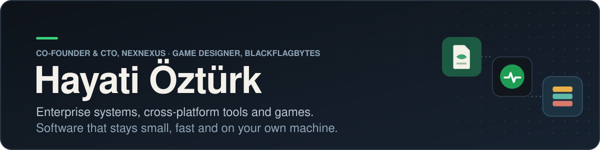
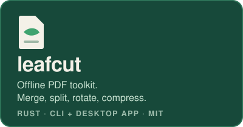
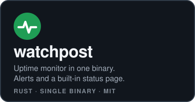
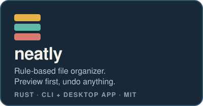

  

  <a href="https://github.com/hytztrk-ux">English</a> · <b>Türkçe</b>

  <a href="https://nexnexus.com">nexnexus.com</a> ·
  <a href="https://www.blackflagbytes.com">blackflagbytes.com</a> ·
  <a href="https://www.linkedin.com/in/hytztrk">LinkedIn</a>

  
  
  

**[NEXNEXUS](https://nexnexus.com)**'ta mühendisliği yönetiyorum; kurumsal yazılım, özel ERP çözümleri ve
bunları birbirine bağlayan entegrasyonlar geliştiriyoruz. **[BlackFlagBytes](https://www.blackflagbytes.com)**'ta
oyun tasarlıyorum. Arada, var olmasını istediğim küçük araçları yazıp burada yayınlıyorum.

Hepsinin ortak noktası aynı tercih: hafif, tek kod tabanıyla her platformda çalışan ve işe yaraması için
sunucu ya da hesap gerektirmeyen yazılım.

### Açık kaynak

| | Ne yapar | Neden var |
|---|---|---|
| **[leafcut](https://github.com/hytztrk-ux/leafcut/blob/main/README.tr.md)** | PDF'leri masaüstü uygulamasından ya da terminalden birleştirir, böler, döndürür, sıkıştırır | Bir PDF'i düzenlemek için sözleşmenizi bir web sitesine yüklemek zorunda kalmamalısınız |
| **[watchpost](https://github.com/hytztrk-ux/watchpost/blob/main/README.tr.md)** | Siteleri, portları ve TLS sertifikalarını izler; uyarı gönderir, durum sayfası sunar | Küçük bir sunucuyu izlemek, sunucunun ayırabileceğinden fazla bellek harcamamalı |
| **[neatly](https://github.com/hytztrk-ux/neatly/blob/main/README.tr.md)** | Birkaç TOML kuralıyla çalışan dosya düzenleyici | İndirilenler klasörünü toplamak, ancak önce önizleyip sonra geri alabiliyorsanız güvenlidir |

Üçü de Rust ile yazıldı, MIT lisanslı, İngilizce ve Türkçe belgeli; Linux, macOS ve Windows için hazır
derlenmiş sürümleri var.

Ayrıca: **[DD:YZ](https://github.com/hytztrk-ux/SansursuzLokalAIStudyosu-DDYZ)**, görsel, sohbet ve ses
modellerini yerelde çalıştıran taşınabilir bir stüdyo.

### Günlük iş

- **Kurumsal sistemler.** Canias ERP ve TROIA üzerinde ERP mimarisi ve özelleştirme, backend servisleri ve bunları diğer her şeye bağlayan REST ve SOAP entegrasyonları.
- **Çapraz platform ürünler.** Tek kod tabanından masaüstü ve sunucu yazılımı; çoğunlukla Go, Rust, Tauri 2 ve PostgreSQL ile.
- **Oyun.** BlackFlagBytes'ta tasarım ve araç geliştirme.
- **Yerel yapay zekâ.** Kendi donanımınızda çalışan modeller ve araçlar.

Klavye başında değilken: elektro gitar koleksiyonu ve müzik.

---

<table>
  <tr><td><b>Diller</b></td><td>Rust · Go · JavaScript · TROIA</td></tr>
  <tr><td><b>Masaüstü ve çalışma ortamı</b></td><td>Tauri 2 · Node.js</td></tr>
  <tr><td><b>Veri ve entegrasyon</b></td><td>PostgreSQL · SQLite · REST / JSON · SOAP / XML</td></tr>
  <tr><td><b>Kurumsal</b></td><td>Canias ERP</td></tr>
</table>

Ankara

